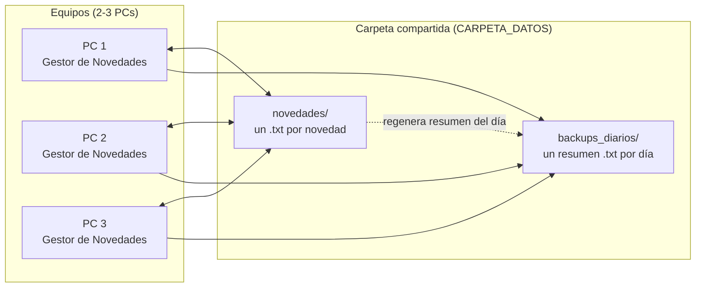
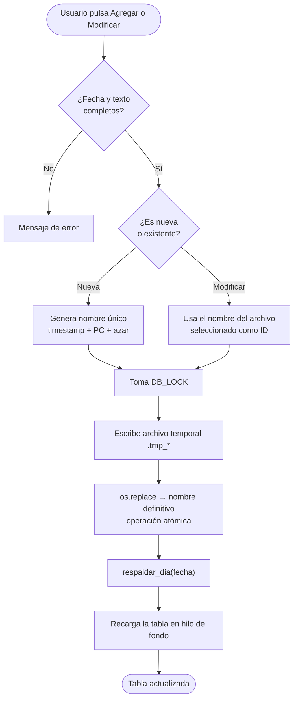
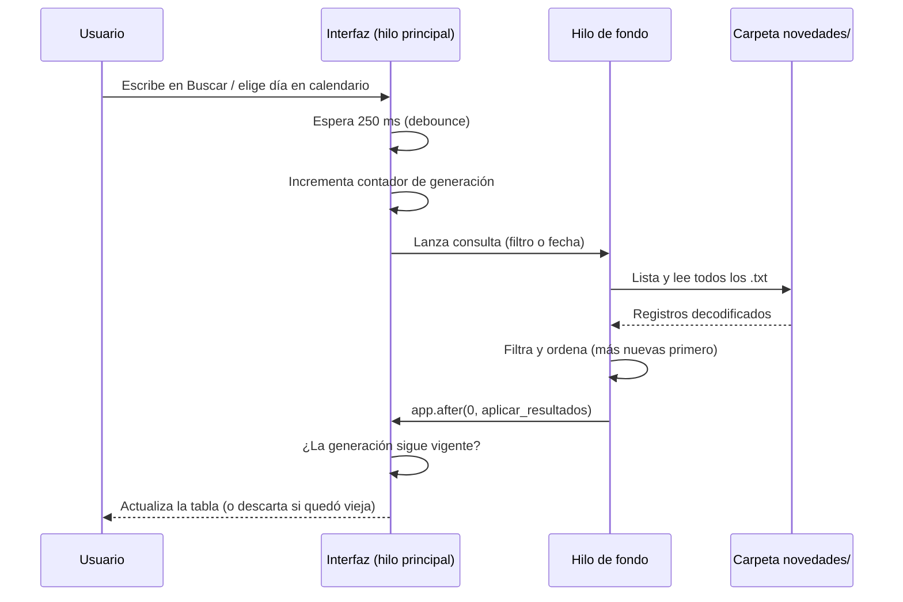
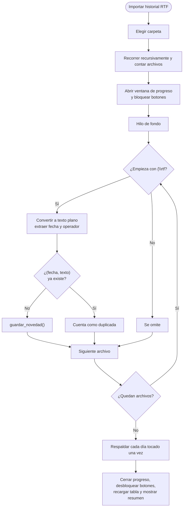

[README.md](https://github.com/user-attachments/files/35383018/README.md)
# 🗒️ Gestor de Novedades

Aplicación de escritorio para registrar, buscar y respaldar las **novedades operativas diarias** de un turno de trabajo. Está pensada para que **2–3 PCs compartan el mismo registro** a través de una carpeta de red, sin riesgo de que se pisen o corrompan los datos cuando varios operadores escriben a la vez.

Interfaz oscura con estética neón (cyan / magenta) construida con [CustomTkinter](https://github.com/TomSchimansky/CustomTkinter).

> **Versión:** 1.10 (el archivo es `GestorNovedades_1_10.py`)
> **Plataforma:** Windows
> **Autor:** Facundo Pérez · GitHub: [TheBlackMarc](https://github.com/TheBlackMarc) · Marctech

---

## ✨ Características

- **ABM de novedades**: agregar, modificar y eliminar registros (fecha, operador y texto libre multilínea).
- **Almacenamiento sin base de datos**: cada novedad es un archivo `.txt` independiente. Sin SQLite, sin servidor.
- **Multi-PC seguro**: nombres de archivo únicos + escritura atómica, para que varios equipos escriban simultáneamente sobre una carpeta compartida.
- **Búsqueda en vivo** sobre fecha, operador y texto (sin distinguir mayúsculas), con *debounce* de 250 ms y resaltado de coincidencias en el editor.
- **Calendario lateral**: un clic filtra las novedades de ese día; un segundo clic sobre el mismo día quita el filtro.
- **Respaldo diario automático**: genera un resumen legible `aaaa-mm-dd.txt` por cada día con novedades.
- **Importador de historial RTF**: convierte una carpeta de archivos `.rtf` antiguos en novedades, detectando duplicados y mostrando una barra de progreso.
- **Interfaz fluida**: toda lectura de disco/red y la importación corren en hilos de fondo para no congelar la ventana.
- **Limpiar / Retroceso**: limpia el formulario y permite recuperar lo que había antes de limpiar.
- 
main/captura-principal.png
---

## 📋 Requisitos

| Requisito | Detalle |
|---|---|
| Sistema operativo | **Windows** (usa la variable de entorno `APPDATA` y las fuentes *Segoe UI* y *Consolas*) |
| Python | 3.8 o superior, con **tkinter** incluido (viene con el instalador oficial de Python) |
| Dependencias externas | `customtkinter`, `tkcalendar` |
| Dependencia indirecta | `babel` (la instala `tkcalendar`; se usa para el calendario en español `es_ES`) |
| Librería estándar usada | `os`, `re`, `socket`, `uuid`, `tempfile`, `threading`, `datetime`, `getpass`, `tkinter` |

### Instalación

```bash
git clone https://github.com/TheBlackMarc/<nombre-del-repo>.git
cd <nombre-del-repo>
pip install customtkinter tkcalendar
```

### Ejecución

```bash
python GestorNovedades_1_10.py
```

---

## ⚙️ Configuración: carpeta de datos compartida

Por defecto, los datos se guardan en una carpeta **local** de cada equipo:

```
%APPDATA%\GestorNovedades
```

Con esa configuración **cada PC tiene su propio registro y no comparten nada**. Para que varias PCs vean las mismas novedades hay que apuntar `CARPETA_DATOS` a una carpeta de red con permisos de lectura y escritura para todos los equipos. Editá esta línea al inicio del script:

```python
# Ruta UNC
CARPETA_DATOS = r"\\PC-PRINCIPAL\NovedadesCompartidas"

# o una unidad de red mapeada
CARPETA_DATOS = r"Z:\NovedadesCompartidas"
```

El programa crea automáticamente las subcarpetas que necesita.

---

## 🖥️ Uso

### Panel izquierdo

| Elemento | Función |
|---|---|
| **Fecha** | Formato `dd/mm/aaaa`. Por defecto, la fecha de hoy. |
| **Usuario** | Operador que registra la novedad. Por defecto, el usuario de Windows. |
| **Buscar** | Filtra la tabla en vivo por fecha, usuario o texto. |
| **Agregar** | Crea una novedad nueva con los datos del formulario. |
| **Modificar** | Sobrescribe la novedad seleccionada en la tabla. |
| **Eliminar** | Borra la novedad seleccionada. |
| **Importar historial RTF** | Importa en lote archivos `.rtf` desde una carpeta. |
| **Limpiar** | Vacía el formulario (restaura fecha de hoy y usuario actual). |
| **Retroceso** | Deshace el último "Limpiar". |
| **Calendario** | Filtra por día. Clic en el mismo día de nuevo = quita el filtro. |
| **Mostrar todas** | Quita el filtro de calendario. |
| **Acerca de** | Información del programa. |

### Panel derecho

- **Tabla** con columnas *Fecha*, *Operador* y *Novedad*. Al seleccionar una fila, sus datos se cargan en el formulario y en el editor.
- **Editor de texto** para redactar o editar el contenido de la novedad. Resalta las coincidencias de la búsqueda activa.

### Comportamiento de la tabla

- Sin búsqueda ni filtro de fecha se muestran solo las **5 novedades más recientes** (`LIMIT_TABLA`), para que la apertura sea rápida aunque haya miles de registros.
- Con una **búsqueda** o un **día seleccionado** se muestran **todas** las coincidencias, sin límite.

---

## 🧠 Cómo funciona

### Modelo de datos: un archivo por novedad

En lugar de una base de datos única compartida por red (que puede corromperse o bloquearse con escrituras simultáneas), cada novedad se guarda como un `.txt` independiente con este formato:

```text
FECHA: 24/11/2026
USUARIO: operador1
===
Texto libre de la novedad,
puede tener varias líneas.
```

La cabecera (`FECHA`, `USUARIO`) y el cuerpo se separan con la línea `===`.

### Nombre de archivo único

```
aaaammddHHMMSSffffff_NOMBREPC_a1b2c3.txt
└────── timestamp ────┘ └─ equipo ─┘ └ azar ┘
```

- **Timestamp con microsegundos**: ordenar por nombre equivale a ordenar cronológicamente.
- **Nombre del equipo** (saneado) + **sufijo aleatorio** (`uuid`): hace prácticamente imposible que dos PCs generen el mismo nombre, incluso en el mismo instante.
- El **nombre del archivo es el ID** de la novedad: viaja en cada fila de la tabla (`iid`), así *Modificar* y *Eliminar* saben exactamente qué archivo tocar sin buscarlo por contenido.

### Escritura atómica

Cada guardado se hace en dos pasos:

1. Se escribe el contenido en un archivo temporal `.tmp_*.txt` **en la misma carpeta**.
2. Se renombra al nombre definitivo con `os.replace()`, que es una operación atómica.

Así, otra PC que esté leyendo la carpeta nunca ve un archivo a medio escribir. Los temporales (`.tmp_*`) se ignoran al listar. Además, un `threading.Lock` serializa las escrituras dentro del mismo proceso.

### Lectura sin congelar la interfaz

Cada consulta (búsqueda, filtro por día, recarga) se ejecuta en un **hilo de fondo** que lee y decodifica todos los `.txt`, filtra, ordena (más nuevas primero) y entrega el resultado al hilo principal con `app.after(0, ...)`. Un **contador de generación** descarta resultados de consultas viejas que terminen después de otra más reciente, evitando que una búsqueda superada pise a la actual.

### Respaldo diario

Cada vez que se agrega, modifica, elimina o importa una novedad, se regenera el resumen legible del día afectado en `backups_diarios/aaaa-mm-dd.txt`:

```text
Novedades del 24/11/2026
========================================

Operador: operador1
--------------------
Texto de la novedad...
```

- Si un día se queda sin novedades, su resumen se elimina.
- Si una novedad cambia de fecha al modificarla, se actualizan **ambos** días (origen y destino).
- En el primer arranque, si `backups_diarios/` está vacía, se generan todos los resúmenes en segundo plano.
- Los `.txt` individuales son la **fuente de verdad**; los resúmenes diarios son solo una copia legible.

### Importación de historial RTF

1. Se elige una carpeta; se recorre **recursivamente** y se cuentan todos los archivos para mostrar progreso real.
2. Solo se procesan los que empiezan con la firma `{\rtf`.
3. Se convierte el RTF a texto plano (`\par` → salto de línea, `\tab` → tabulación, se eliminan comandos de control, llaves y tablas de fuentes/colores).
4. **Fecha**: si el nombre del archivo tiene 8 dígitos (`aaaammdd`) se usa esa fecha; si no, la de hoy.
5. **Operador**: se intenta extraer del texto con el patrón `TURNO ... -OPERADOR-`.
6. **Duplicados**: se compara `(fecha, texto)` contra un conjunto armado una sola vez al inicio. Los repetidos se omiten.
7. Al terminar se respaldan los días tocados (una sola vez por día) y se muestra un resumen: detectados, importados, duplicados y errores.

Mientras corre la importación, los botones Agregar / Modificar / Eliminar / Importar quedan bloqueados.

---

## 🔄 Diagrama de funcionamiento

### Arquitectura general



### Flujo de guardado (Agregar / Modificar)



### Flujo de lectura y búsqueda



### Flujo de importación RTF



---

## 📁 Estructura

### Del proyecto

```
.
├── GestorNovedades_1_10.py   # Aplicación completa (un solo archivo)
└── README.md
```

### De los datos (se crea sola al ejecutar)

```
CARPETA_DATOS/
├── novedades/                              # Fuente de verdad: 1 archivo por novedad
│   ├── 20261124083015123456_PC1_a1b2c3.txt
│   ├── 20261124091244987654_PC2_d4e5f6.txt
│   └── ...
└── backups_diarios/                        # Resúmenes legibles por día
    ├── 2026-11-23.txt
    ├── 2026-11-24.txt
    └── ...
```

### Del código (`GestorNovedades_1_10.py`)

| Sección | Contenido |
|---|---|
| **Paleta y fuentes** | Constantes de color (`GLOW_CYAN`, `GLOW_MAG`, `PANEL`, …) y tipografías. |
| **Ubicación de datos** | `CARPETA_DATOS`, `CARPETA_NOVEDADES`, `CARPETA_BACKUP_TXT`, `DB_LOCK`. |
| **Capa de datos** | `_nombre_equipo`, `_generar_nombre_archivo`, `_escribir_archivo_atomico`, `_codificar_novedad`, `_decodificar_novedad`, `guardar_novedad`, `eliminar_novedad`, `_leer_registro`, `obtener_todas_las_novedades`. |
| **Respaldos** | `_nombre_archivo_dia`, `respaldar_dia`, `_generar_backups_iniciales_si_hace_falta`. |
| **Componentes visuales** | `_glow_panel`, `_neon_button`, `_entry_neon`, divisor con degradé, estilos de `Treeview` y scrollbar. |
| **Ventanas auxiliares** | `acerca_de`, `_ventana_progreso`. |
| **Importación** | `importar_historial_rtf`, `_bloquear_botones`. |
| **Carga y búsqueda** | `_pedir_carga`, `_aplicar_resultados`, `cargar`, `cargar_por_fecha`, `_programar_busqueda`, `resaltar_busqueda`. |
| **Acciones del formulario** | `agregar`, `modificar`, `eliminar`, `seleccionar`, `limpiar_formulario`, `deshacer_limpiar`. |
| **Calendario y arranque** | Widget `Calendar`, `actualizar_fecha`, `mostrar_todas`, y el `mainloop`. |

---

## ⚠️ Limitaciones conocidas

- **Solo Windows**: depende de `os.environ["APPDATA"]`; en otros sistemas fallaría al iniciar.
- **Edición simultánea del mismo registro**: si dos PCs modifican *la misma* novedad a la vez, gana la última en guardar (no hay control de versiones). Agregar novedades nuevas sí es seguro en paralelo.
- **`DB_LOCK` es local al proceso**: protege entre hilos de una misma PC; entre PCs la seguridad la dan los nombres únicos y el renombrado atómico.
- **Escalabilidad**: cada consulta lee todos los `.txt`. Con decenas de miles de novedades sobre una red lenta puede tardar.
- **Sin autenticación**: el campo *Usuario* es editable y solo informativo.
- **Importador RTF**: la conversión es heurística (expresiones regulares), no un parser RTF completo; el RTF con formato complejo puede dejar restos de texto.

---

© 2026 Facundo Pérez · [Marctech](https://github.com/TheBlackMarc)
